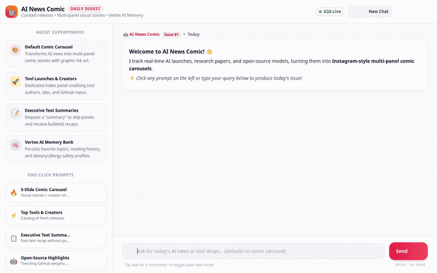

# AI News Comic 🤖🎨

AI News Comic is an intelligent, visual news curation agent built with the **Google Agent Development Kit (ADK)** and deployed on **Google Cloud Agent Engine / Agent Runtime**. It monitors real-time AI research and developer releases, synthesizes daily events, and visualizes them as multi-panel, Instagram-style comic carousels rendered directly in a responsive web interface.



---

## 🌟 What the Agent Does

1. **Monitors Real-Time AI News & Launches**: Fetches trending AI research papers, model releases, and open-source projects using live public data APIs and an indexed database.
2. **Visual Multi-Panel Comic Carousels by Default**:
   - By default, every news query generates a sequential visual comic carousel (up to 7 slides).
   - **Slide 1**: Features an *"All Announcements & Tools Index"* showcase marquee highlighting all tools released and who launched them.
   - **Remaining Slides**: Detailed comic narrative panels with bold graphic inks, character dialogue, and deep-dive technical explainers.
   - **Instagram-Style Navigation Footers**: Each slide includes date metadata, logo branding, and swipe pagination dots (e.g., `◀ Swipe ➔ [Slide 1/5] ●○○○○`).
   - **Text Summary Exception**: Generates clean, concise text summaries only when explicitly requested by the user.
3. **Cross-Session Long-Term Memory & Safety Profile**:
   - Integrates Vertex AI Memory Bank to retain user reading interests, favorite AI labs, and technical focus areas across conversation sessions.
   - Tracks and strictly respects user dietary and allergy constraints across all sessions.
4. **Sandboxed Code Execution**: Executes Python code in a dedicated Agent Engine sandbox environment for date math, ranking algorithms, and data parsing.

---

## ☁️ Google Cloud Services & Architecture

The agent strictly implements and connects the following cloud services and components:

| Component / Service | Implementation in Code | Role & Functionality |
|---------------------|------------------------|----------------------|
| **Vertex AI Gemini 3.8 Flash** | `app/agent.py` (`MODEL = "gemini-3.8-flash"`) | Core reasoning, multi-turn conversation, tool dispatch, and prompt engineering. |
| **Vertex AI Gemini 3.1 Flash Lite Image** | `app/tools.py` (`IMAGE_MODEL = "gemini-3.1-flash-lite-image"`, region `global`) | Generates polished, stylized comic illustrations and marquee panels in parallel via `generate_comic_carousel`. |
| **Vertex AI Memory Bank** | `app/agent.py` (`VertexAiMemoryBankService`, `PreloadMemoryTool`, `generate_memories_callback`) | Cross-session memory extraction and memory retrieval, persisting user preferences and profile facts. |
| **Google Cloud Firestore** | `app/tools.py` (`_get_firestore_client`, collection `ai_announcements`) | Managed NoSQL storage for curated AI announcements (`list_ai_announcements`, `search_announcements`, `add_ai_announcement`). |
| **Google Cloud Storage (GCS)** | `app/tools.py` (`storage.Client`, bucket `ai-comic-digest-media-...`) | Stores generated comic panel assets and provides public HTTPS URLs for inline image rendering. |
| **Agent Engine Sandbox** | `app/agent.py` (`AgentEngineSandboxCodeExecutor`) | Secure code execution sandbox environment for Python analysis and calculations. |
| **A2UI (v0.8 Basic Catalog)** | `app/agent.py`, `app/a2ui_utils.py` (`A2uiSchemaManager`, `BasicCatalog`, `a2ui_callback`) | Generates structured UI surfaces (Cards, Rows, Columns, Text, Images) returned over the A2A protocol. |
| **Hugging Face Daily Papers API** | `app/tools.py` (`fetch_trending_ai_news`) | Real-time trending AI research papers, model releases, and author metadata. |
| **Hacker News Algolia Search API** | `app/tools.py` (`fetch_hackernews_ai_launches`) | Live community developer launches and open-source project drops. |

> **Note on Roadmap / Planned Features**: Video generation with Google Omni was explored during the initial project design brief, but is currently **planned, not yet implemented**. Only static comic illustration panels via Gemini Image are implemented.

---

## 📁 Repository Structure

```
.
├── app/                                # Core agent implementation
│   ├── agent.py                        # Agent definition, system instructions, Memory Bank, callbacks
│   ├── tools.py                        # Firestore, GCS, Image Gen, Hacker News, Hugging Face tools
│   ├── a2ui_utils.py                   # A2UI after-model callback and payload serializer
│   └── fast_api_app.py                 # ADK local app entrypoint
├── frontend/                           # Chat Web Frontend
│   ├── main.py                         # FastAPI proxy communicating over A2A protocol
│   ├── Dockerfile                      # Cloud Run container definition
│   ├── requirements.txt                # Frontend dependencies (fastapi, a2a-sdk, httpx, google-auth)
│   └── static/
│       └── index.html                  # Accessible 2-column Tailwind CSS chat UI with carousels & Lightbox
├── tests/                              # Automated test suites
│   ├── unit/                           # Unit tests for tools and logic
│   └── integration/                    # Integration tests for agent execution
├── agents-cli-manifest.yaml            # Project configuration for Google Agents CLI
├── deployment_metadata.json            # Deployment target IDs and runtime metadata
└── pyproject.toml                      # ADK and Python dependencies
```

---

## 🚀 Local Development & Setup

### Prerequisites

- **Python 3.11+**
- **uv**: Fast Python package manager ([Installation Guide](https://docs.astral.sh/uv/getting-started/installation/))
- **Google Cloud SDK (`gcloud`)**: Authenticated with your Google Cloud project:
  ```bash
  gcloud auth login
  gcloud auth application-default login
  gcloud config set project <YOUR_PROJECT_ID>
  ```

---

### 1. Install Dependencies

Install the root agent dependencies using `uv`:

```bash
uv sync
```

---

### 2. Run the ADK Local Playground

To run the agent locally with hot reloading and long-term memory support:

```bash
export GOOGLE_GENAI_USE_VERTEXAI=true
export GOOGLE_CLOUD_LOCATION=global

uv run adk web . --port 8080 --reload_agents --memory_service_uri=agentengine://<YOUR_AGENT_ENGINE_ID>
```

---

### 3. Run Automated Tests

Execute the unit and integration test suites:

```bash
uv run pytest tests/unit tests/integration
```

---

### 4. Run the Full-Stack Web Frontend Locally

The frontend consists of a lightweight FastAPI proxy talking to the agent over the A2A protocol and a 2-column accessible chat UI.

From the `frontend/` directory:

```bash
cd frontend
python3 -m venv .venv
source .venv/bin/activate
pip install -r requirements.txt

export AGENT_ENGINE_RESOURCE_NAME="projects/<PROJECT_ID>/locations/<REGION>/reasoningEngines/<ENGINE_ID>"
export AGENT_DIRECTORY="app"
export PORT=8080

python main.py
```

Navigate to your local server port in your browser to interact with the full 2-column comic experience.

---

### 5. Deploying the Frontend to Cloud Run

To containerize and deploy the frontend proxy and UI to Google Cloud Run:

```bash
gcloud run deploy ai-news-comic-frontend \
  --source frontend \
  --region <YOUR_REGION> \
  --allow-unauthenticated \
  --service-account <COMPUTE_OR_CUSTOM_SERVICE_ACCOUNT> \
  --set-env-vars AGENT_ENGINE_RESOURCE_NAME="projects/<PROJECT_ID>/locations/<REGION>/reasoningEngines/<ENGINE_ID>",AGENT_DIRECTORY="app"
```

Ensure the Cloud Run runtime service account is granted `roles/aiplatform.user` so it can invoke the Agent Engine backend:

```bash
gcloud projects add-iam-policy-binding <YOUR_PROJECT_ID> \
  --member="serviceAccount:<SERVICE_ACCOUNT_EMAIL>" \
  --role="roles/aiplatform.user"
```
